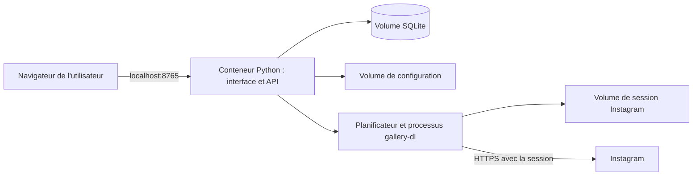

# Architecture

## Distribution et exécution

Reels Library est une application web personnelle à installer chez soi. GitHub distribue le code ; il n'héberge ni les bibliothèques ni les sessions des utilisateurs. Chaque installation est indépendante et sert un seul espace personnel.

Le parcours par défaut est `docker compose up -d --build` sur l'ordinateur de l'utilisateur. Le conteneur exécute Waitress, l'API WSGI, le planificateur et le connecteur Instagram. Le navigateur affiche le frontal HTML/CSS/JavaScript servi par cette même application. Un lancement Python direct reste disponible pour le développement. Un NAS ou un serveur peut également accueillir le conteneur ; ce choix est facultatif.

Le navigateur n'interroge pas Instagram pour synchroniser les sauvegardes. Le connecteur reçoit le chemin du fichier de cookies, jamais ses valeurs dans les arguments. Le téléchargement des médias est désactivé et les configurations globales du connecteur sont ignorées. Le programme gallery-dl est une dépendance séparée avec sa propre licence.

Fermer l'onglet ne stoppe pas le conteneur. Arrêter le conteneur, Docker ou son ordinateur arrête la synchronisation ; les réglages persistés sont repris au prochain démarrage. Aucun démarrage au login, exécutable natif ou service permanent indépendant de Docker n'est installé sur l'hôte.

## Modules

| Module | Responsabilité |
| --- | --- |
| `domain.py` | Validation, normalisation des références et recherche sans accents |
| `importers.py` | Lecture des fichiers et comptabilisation des entrées |
| `database.py` | SQLite, transactions, classement et export |
| `session.py` | Validation, filtrage et écriture atomique de la session |
| `sync.py` | Connecteur, planification, historique et reprise après erreur |
| `web.py` | API WSGI, contrôle des hôtes et origines, authentification |
| `access_key.py` | Création persistante et lecture volontaire de la clé privée |
| `__main__.py` | Configuration par environnement et lancement de Waitress |
| `static/` | Interface de bibliothèque, import, édition et synchronisation |

## Stockage

Le code de l'image est en lecture seule et exécuté avec l'UID 10001. Trois volumes sont modifiables :

- `library_data` : base SQLite, réglages et historiques.
- `instagram_session` : cookies Instagram, hors base et hors export de fiches.
- `app_config` : clé privée créée au premier démarrage, conservée sans régénération automatique.

Le nom de projet Compose par défaut est `reels-library`. Un utilisateur peut le remplacer avec `COMPOSE_PROJECT_NAME` pour isoler une seconde installation et doit alors choisir un autre port. Les données ne suivent pas le code entre deux ordinateurs : il faut les exporter ou sauvegarder les volumes.

La clé et la session sont des fichiers de mode 0600. L'API ne renvoie jamais leurs valeurs ; la clé peut être affichée explicitement dans le terminal via `python -m reels_library.access_key`. La génération est activée explicitement par Compose. Les modes avec clé d'environnement ou fichier géré restent disponibles pour les installations avancées.

Le port hôte est lié à `127.0.0.1`. L'authentification HTTP Basic (`admin` et clé longue), le contrôle de l'hôte, des origines et des requêtes intersites restent actifs. Le profil facultatif `public` ajoute Caddy pour HTTPS et nécessite une origine distante explicite.

## Bibliothèque

Les références sont uniques par identifiant Instagram. Les sources importées sont séparées des corrections personnelles. Un réimport conserve ces corrections ; de nouvelles sources peuvent compléter le texte disponible. Un texte corrigé manuellement garde la priorité.

Les thèmes et collections utilisent des relations multiples. L'état personnel (`to_use`, `in_progress`, `used`, `archived`) est indépendant de la présence technique d'un texte. Une prévisualisation d'import n'écrit rien ; les imports concurrents sont sérialisés avant détection des doublons. Une suppression locale supprime les sources et associations de la fiche, sans agir sur Instagram.

## Synchronisation et limites

- Un seul passage à la fois ; les requêtes de bibliothèque restent disponibles.
- Fenêtre de 50, 200, 1 000 ou 5 000 publications, avec signalement de la limite.
- Réponse partielle contenant une erreur traitée comme un échec, même avec un code de sortie zéro.
- Fiches existantes conservées en cas d'échec ; erreurs présentées sans sortie brute du connecteur.
- Attente allongée après échec et reprise des réglages persistés au démarrage.
- Ancien passage inachevé marqué comme interrompu.
- Retraits dans Instagram sans suppression locale automatique.
- Pas encore de pagination historique persistante ni de récupération des collections Instagram.
- Pas de renouvellement automatique du fichier de session.

L'accès Instagram réel reste à valider. Les tests automatisés emploient des réponses simulées. Une utilisation partagée avec plusieurs comptes demanderait une isolation supplémentaire ; la version actuelle prévoit une seule instance applicative par bibliothèque.
